<p align="center">
  
  <h1 align="center">PySimpleGUI Playground</h1>
  <h3 align="center">Programs I use every day, written in PySimpleGUI</h3>
</p>


I'm a heavy Windows user.  PySimpleGUI was written specifically to help me write a Windows program after I struggled to code using the normal GUI OO SDKs.  It's the only way I know how to make programs for myself that I can use on Windows.  Naturally, when I began experimenting with LLMs, I stuck with having all my tools written in PySimpleGUI, only this time I managed to partner up with a PySimpleGUI expert.

All of these programs were written over the past 10 weeks of me poking at Claude to see what it can do.... and wow, it can do.  I wrote some myself a long time ago as Demo Programs and had Claude make them better.  Several of these were written in the past couple of days.  Often 5 or 10 minutes was all that was needed to write the complete app.

The Playground idea is to share what I think are some interesting designs in a place where it's clear these are **AI-authored applications**.  The Toybox is the Demo Browser reimagined and polished.  Have fun!  

## Installing

One pip command installs everything, including the **Toybox** - the program that shows you what's here and runs it:

```
python -m pip install --upgrade https://github.com/PySimpleGUI/psgplayground/zipball/main
psgplayground
```

Use `python3` on Mac and Linux. If `psgplayground` isn't on your PATH, `python -m psgplayground` does the same thing.

You need Python 3.8 or later and PySimpleGUI 6. Most of the programs run anywhere; the ones marked **Windows** use the Win32 API.

## The Toybox

<p align="center">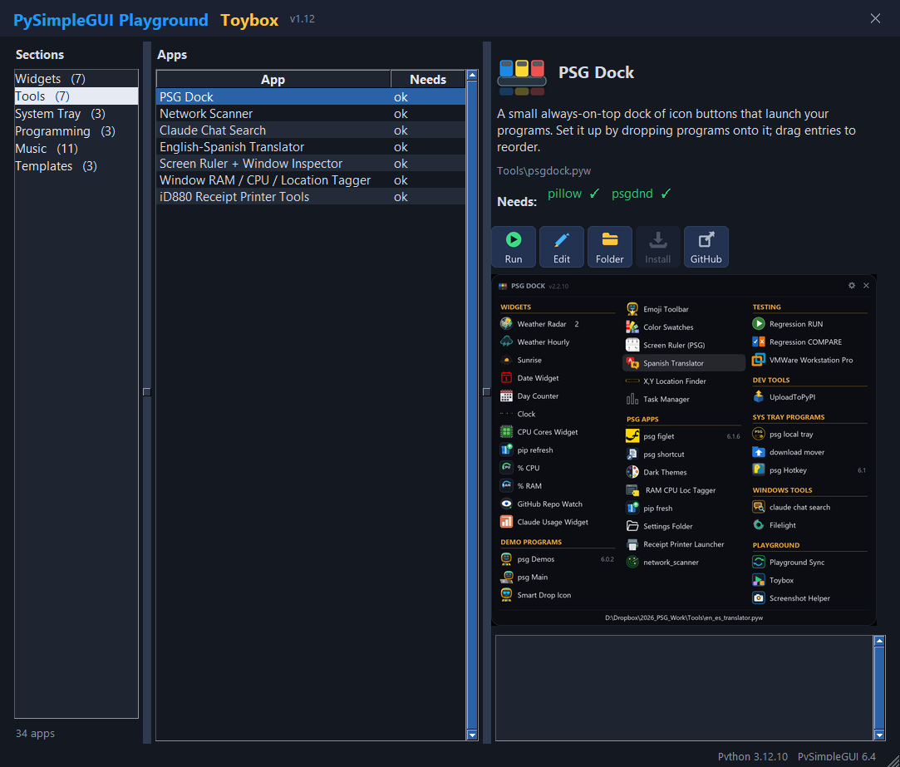</p>

Pick a section on the left and a program in the middle. On the right you'll see what it does and which packages it needs (green means installed).
**Run** starts it, **Edit** opens the source in your editor, **Install missing** runs pip for you, **Open folder** takes you to the file.
The three panes can be dragged to whatever widths you like; the window remembers them.

## Built-in themes

The widgets (% CPU, % RAM, Clock, Pip Refresh) and PSG Dock carry their own 32 themes, 16 dark and 16 light, apart from PySimpleGUI's.
Right-click one and pick a theme by its color chip in the **Theme** menu; it changes as you choose.
**Brightness...** then makes that theme darker or lighter with a slider, so each theme comes in many shades.
The Widget Template has all of it, ready for a widget of your own.

## What's here

Paths are inside the `psgplayground` package - in this repo, or in site-packages once you've installed it.

<!-- PROGRAMS START: a sync writes everything from here to PROGRAMS END from catalog.json - change the catalog, not these tables  (sync 618417d1af09) -->

### Widgets

Small (optionally) always-on-top desktop widgets that sit in a corner and quietly keep you informed.

| Program | What it does | Needs |
|---|---|---|
| <br>**GitHub Repo Watch** | Notices commits, releases and issues on the repos (or whole accounts) you watch - because GitHub never emails you about plain pushes.<br>`Widgets/github_repo_watch.pyw`<br><a href="psgplayground/screenshots/github_repo_watch.png">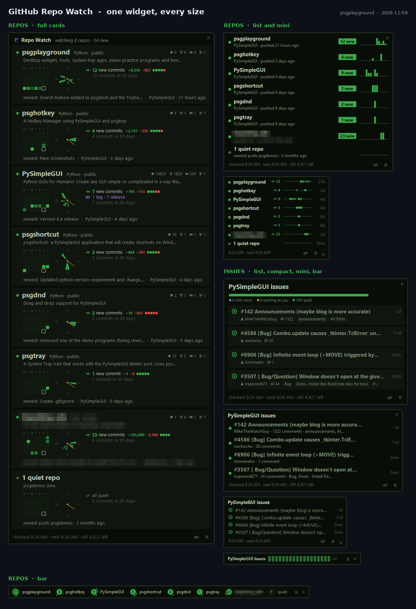</a> | - |
| 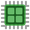<br>**CPU Cores Widget** | One scrolling graph per core. Click a core to see which processes are running on it.<br>`Widgets/cpu_cores_widget.pyw`<br><a href="psgplayground/screenshots/cpu_cores_widget.png">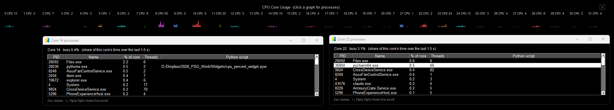</a> | psutil (optional: pywintrace) |
| <br>**CPU % Widget** | CPU load on a ring gauge that goes green to amber to red, with a sparkline of the last minute. No title bar; right-click for 32 themes.<br>`Widgets/cpu_percent_widget.pyw`<br><a href="psgplayground/screenshots/cpu_percent_widget.png">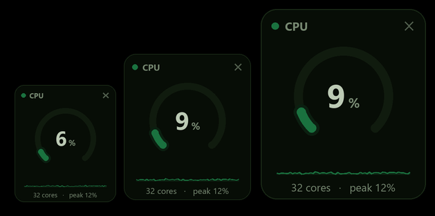</a> | psutil, pillow |
| <br>**RAM % Widget** | Memory in use on the same ring-gauge card - GB used of the total, and a sparkline. Themes, sizes and opacity on the right-click menu.<br>`Widgets/ram_percent_widget.pyw`<br><a href="psgplayground/screenshots/ram_percent_widget.png">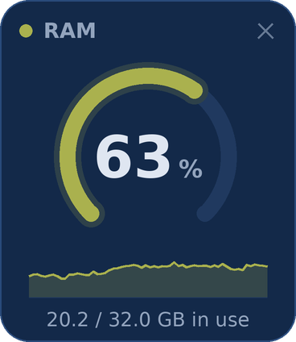</a> | psutil, pillow |
| 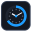<br>**Clock Widget** | The time and the date on a small card, with a bar that fills up every minute. 12 or 24 hours, 32 themes, Brightness, sizes and opacity on the right-click menu.<br>`Widgets/clock_widget.pyw`<br><a href="psgplayground/screenshots/clock_widget.png">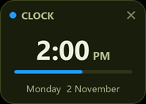</a> | pillow |
| <br>**Pip Refresh** | Your pip packages beside their latest release on PyPI and newest version on GitHub - click one to pick a version (GitHub's newest or any PyPI release) and install it. Edit the list in a Settings window.<br>`Widgets/pip_refresh.pyw`<br><a href="psgplayground/screenshots/pip_refresh.png">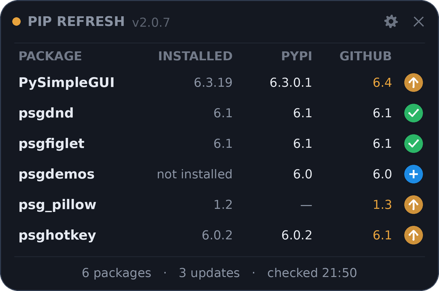</a> | pillow (optional: psgdnd) |
| <br>**Claude Usage Widget** | How much of your Claude plan is used, per limit, with a forecast of when you'll hit the wall.<br>`Widgets/claude_usage_widget.pyw`<br><a href="psgplayground/screenshots/claude_usage_widget.png">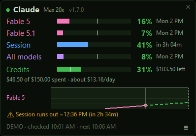</a> | - |

### Tools

Everyday utilities - a program dock, a network scanner, a task manager, chat search, a translator, screen and window inspectors, printer tools.

| Program | What it does | Needs |
|---|---|---|
| <br>**PSG Dock** | A small always-on-top dock of icon buttons that launch your programs. Set it up by dropping programs onto it; drag entries to reorder.<br>`Tools/psgdock.pyw`<br><a href="psgplayground/screenshots/psgdock.png">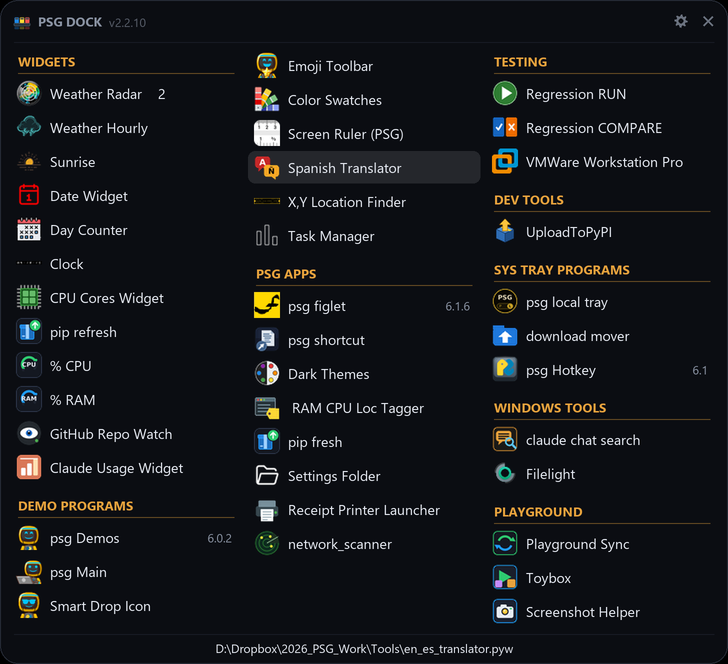</a> | pillow, psgdnd |
| <br>**Network Scanner** | Every device on your LAN as a color-coded tile: names, IPs, MACs, open ports, kind. Standard library only - runs on Python 3.6+.<br>`Tools/network_scanner_v2.pyw`<br><a href="psgplayground/screenshots/network_scanner_v2.png">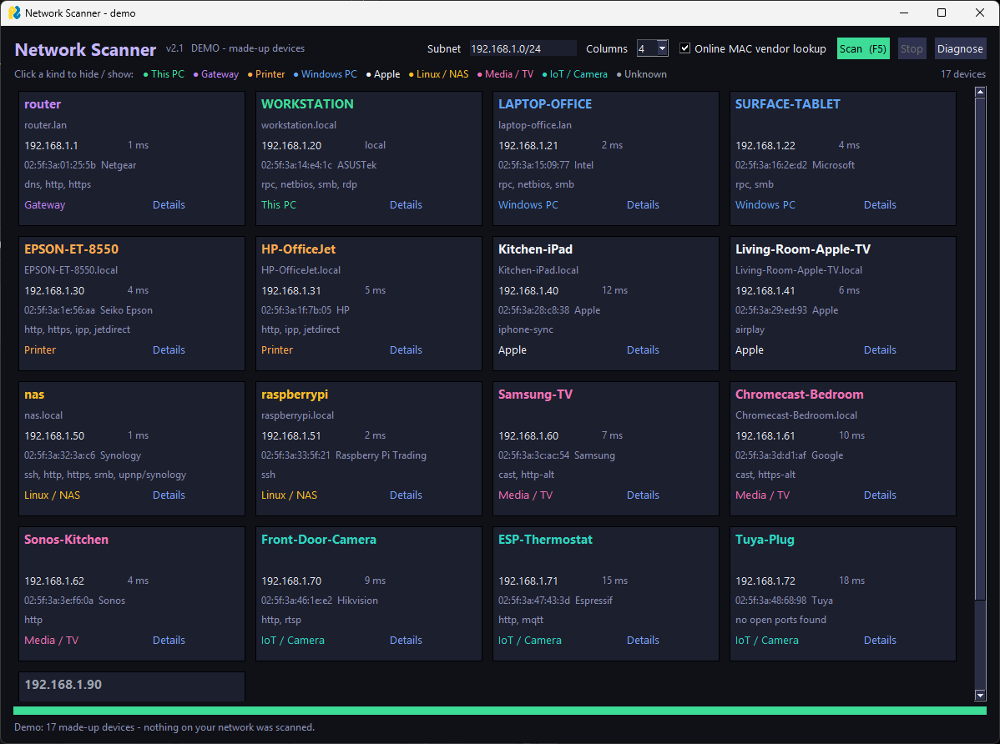</a> | - |
| <br>**Task Manager** | Every running process with its CPU, memory, threads and command line, kept up to date in place. Type to filter, click a heading to sort, Delete ends a process and all it started.<br>`Tools/task_manager.pyw`<br><a href="psgplayground/screenshots/task_manager.png">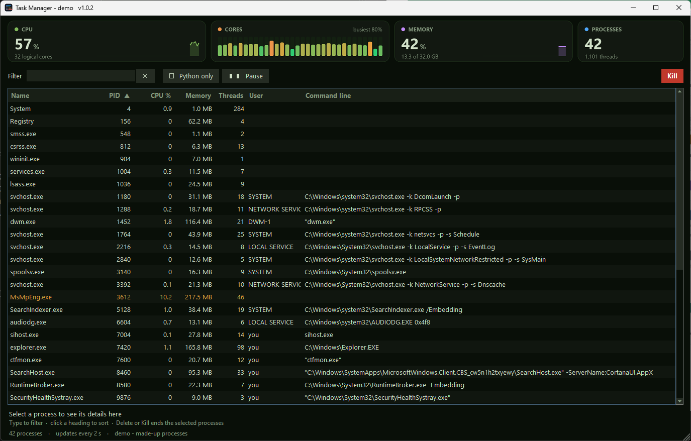</a> | psutil, pillow |
| <br>**Claude Chat Search** | Full-text search of every Claude chat you ever had, from Claude's data export - including the tool steps the built-in search can't see.<br>`Tools/claude_chat_search.pyw`<br><a href="psgplayground/screenshots/claude_chat_search.png">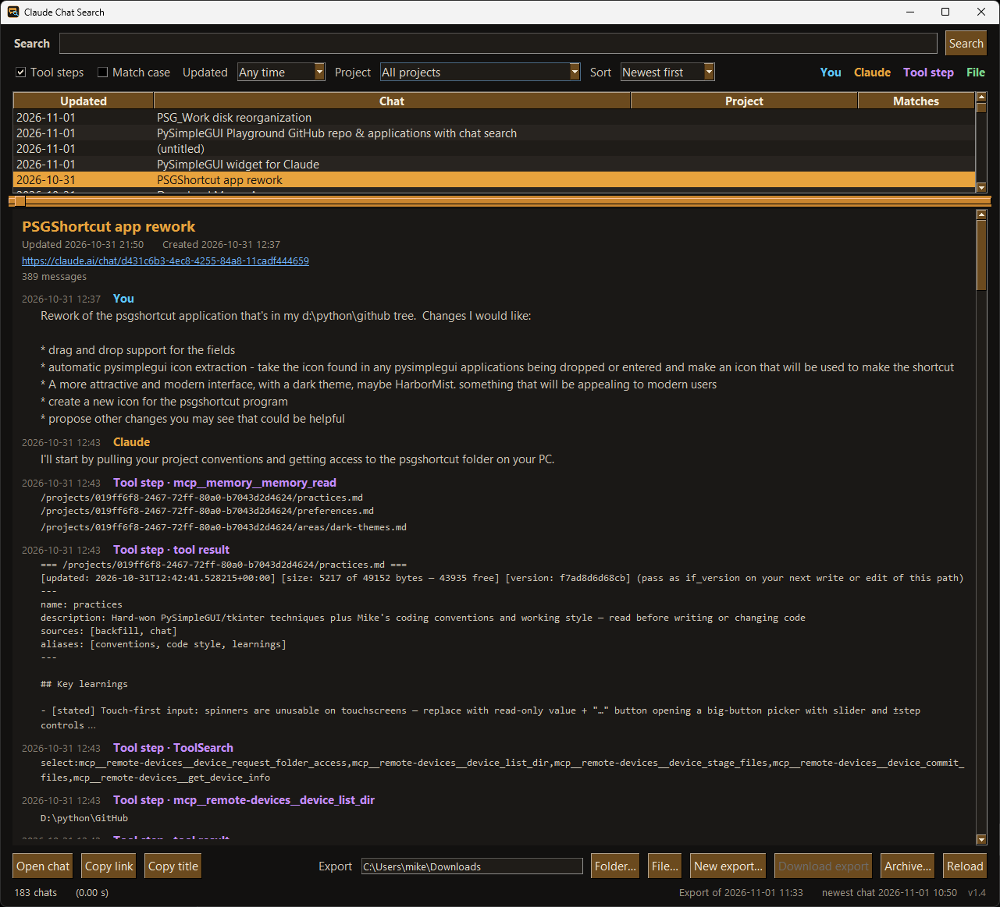</a> | - |
| <br>**English-Spanish Translator** | Translate from the clipboard, by drag-and-drop from any app, or by typing. Four engines, cached.<br>`Tools/en_es_translator.pyw`<br><a href="psgplayground/screenshots/en_es_translator.png">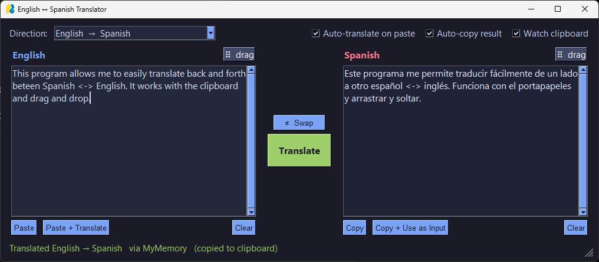</a> | deep-translator, psgdnd (optional: argostranslate) |
| <br>**Screen Ruler + Window Inspector**<br>**Windows** | Drag to measure anything on screen, drop rulers, inspect windows WinSpy-style, save the rectangle as a screenshot.<br>`Tools/psgScreenRuler2.pyw`<br><a href="psgplayground/screenshots/psgScreenRuler2.png">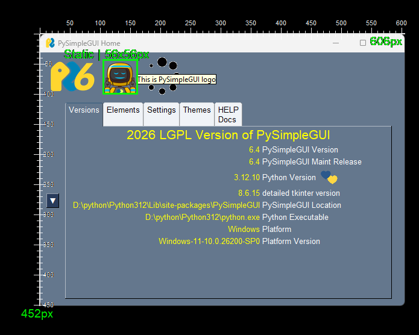</a> | pywin32, keyboard, mouse, pillow |
| <br>**Window RAM / CPU / Location Tagger**<br>**Windows** | Outlines every window on screen and labels it with its RAM, CPU and position. F6/F7/F8 toggle each.<br>`Tools/window_ram_tagger_with_cpu_location.pyw`<br><a href="psgplayground/screenshots/window_ram_tagger_with_cpu_location.png">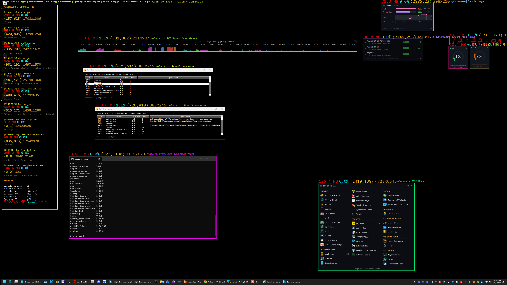</a> | pywin32, keyboard, psutil |
| <br>**iD880 Receipt Printer Tools**<br>**Windows** | Six programs for a cheap thermal printer: setup, notes, address labels, 4x6 shipping labels from carrier PDFs, pictures, FIGlet banners.<br>`Tools/iD880/iD880_Launcher.pyw`<br><a href="psgplayground/screenshots/iD880_Launcher.png">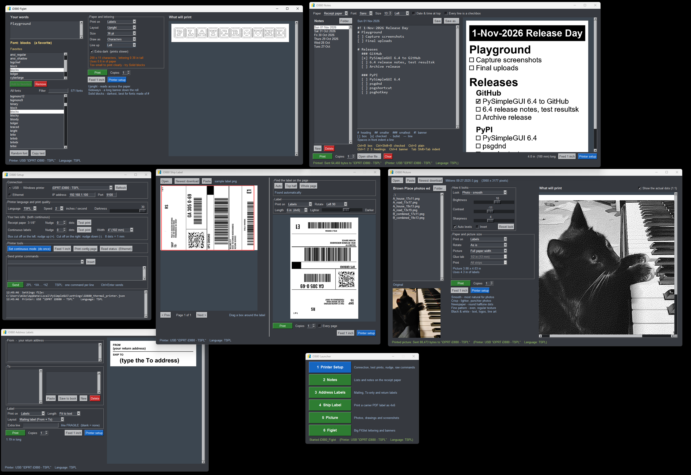</a> | pillow, pywin32, pymupdf, pyfiglet, psgdnd |

### System Tray

Programs that live in the system tray, out of the way until you need them - right-click the icon for the menu.

| Program | What it does | Needs |
|---|---|---|
| 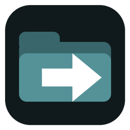<br>**Download Mover** | Tray watcher for your Downloads folder - a new file pops up an Inbox, pick where it goes, Move or Copy, Undo.<br>`Tray/download_mover.pyw`<br><a href="psgplayground/screenshots/download_mover.png">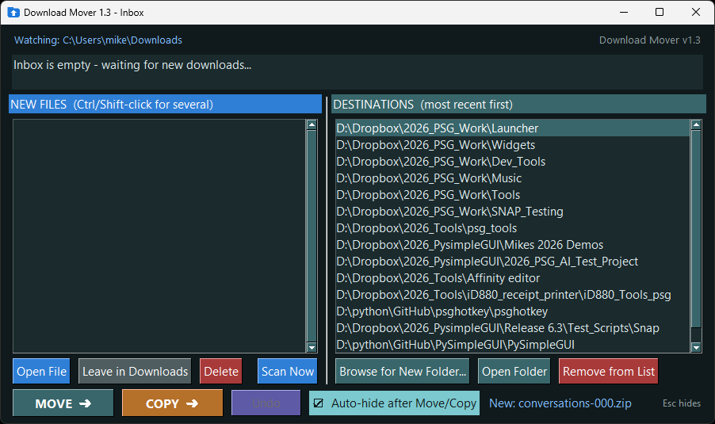</a> | psgtray, pystray, pillow (optional: watchdog) |
| 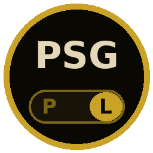<br>**PSG Local Tray** | Tray switch: do programs on this Python import your local PySimpleGUI repo or the pip-installed copy? L / P at a glance.<br>`Tray/psg_local_tray.pyw`<br><a href="psgplayground/screenshots/psg_local_tray.png">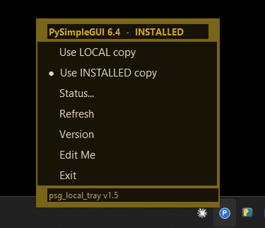</a> | psgtray, pillow |
| 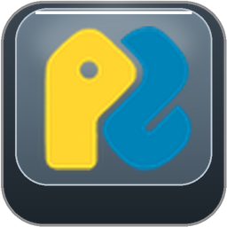<br>**psghotkey**<br>**Windows** | Global hotkeys that type text or launch programs, from the tray. Lives in its own repo - pip install psghotkey.<br>`pip install psghotkey`<br><a href="psgplayground/screenshots/psghotkey.png">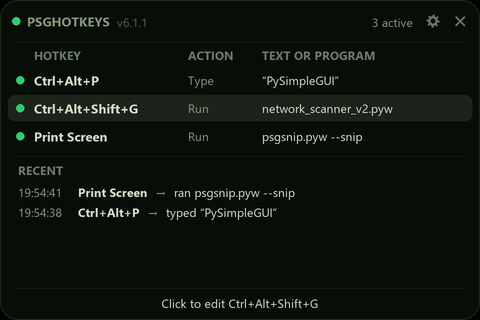</a> | - |

### Programming

Tools that help with PySimpleGUI programming - screenshot regression tests and a previewer for dark themes.

| Program | What it does | Needs |
|---|---|---|
| <br>**Snapshot Test Runner** | Runs the SNAP_*.py screenshot tests against any PySimpleGUI.py you point it at - installed or a local folder - and labels the run.<br>`Programming/snap_regression/run_snapshots_gui.py`<br><a href="psgplayground/screenshots/run_snapshots_gui.png">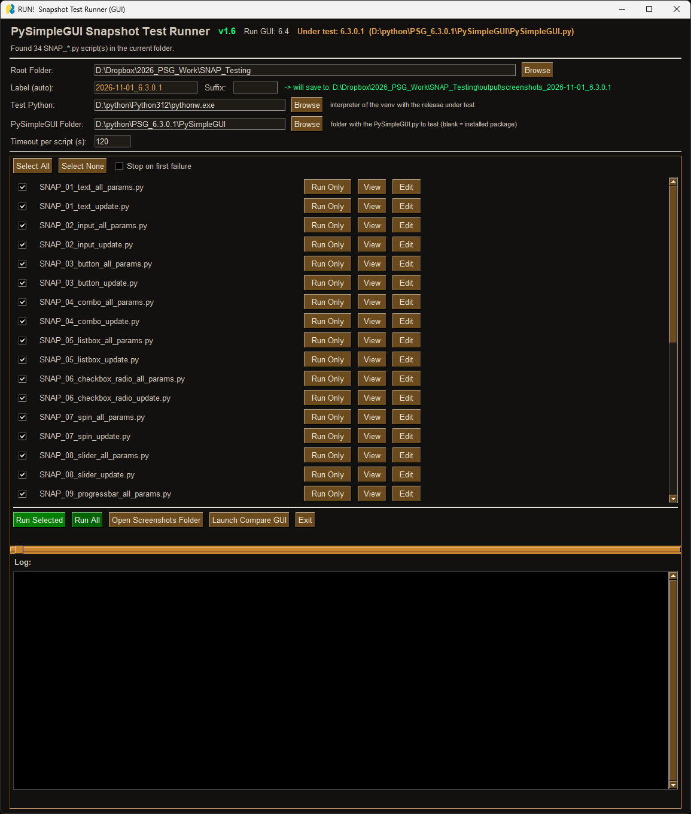</a> | pillow, psgdnd |
| <br>**Snapshot Compare** | Pixel-compares two labeled runs and writes a release-ready report.html plus a GitHub-issue-ready report.md and flagged image.<br>`Programming/snap_regression/compare_screenshots_gui.py`<br><a href="psgplayground/screenshots/compare_screenshots_gui.png">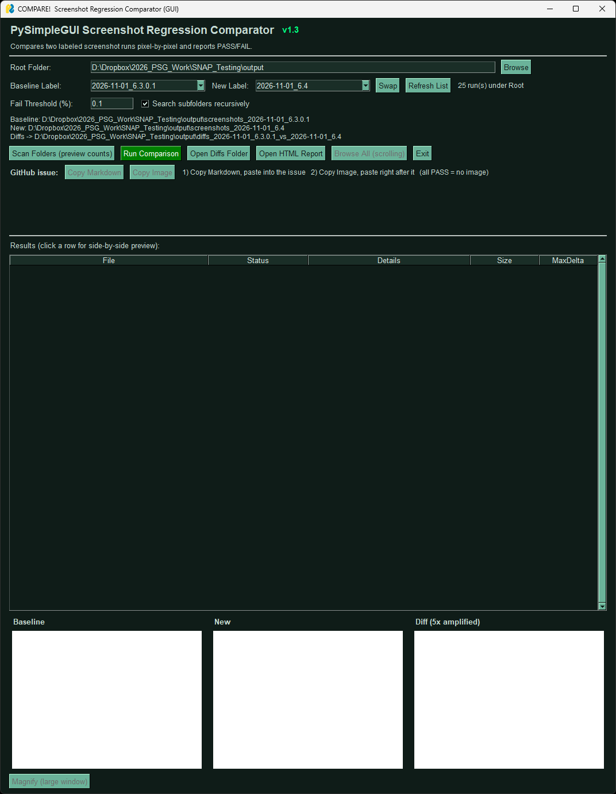</a> | pillow |
| <br>**Dark Theme Preview** | Dozens of custom dark PySimpleGUI themes with a previewer - view them all at once or try one live. Copy the dict into your program.<br>`Programming/dark_theme_preview.py`<br><a href="psgplayground/screenshots/dark_theme_preview.png">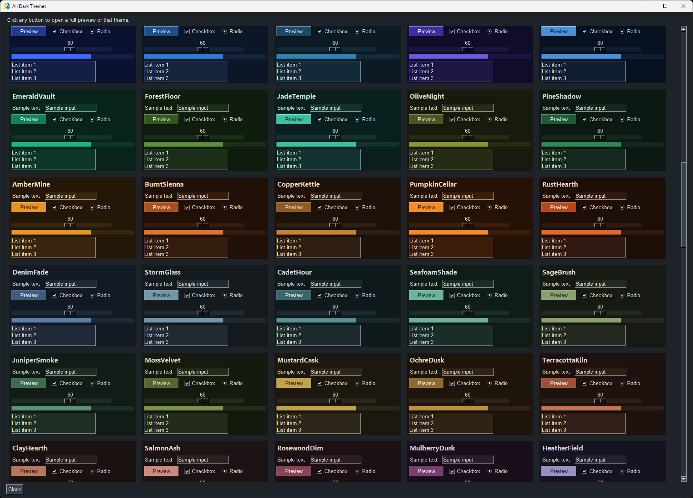</a> | - |

### Music

MIDI piano practice tools. Plug in a MIDI keyboard, pick its port, play - every one of these listens and shows you something interesting and maybe even helpful.  I use the Tempo and Harmony Wheel daily.  I was using the Staff Trainer for a few weeks working on music theory.

There's one additional music application, Player Coach, that I use constantly when playing/practicing.  I want to spend a little more time getting that one documented first.

> [!WARNING]
> Lightly tested. I've only run these on Windows, a few of them only briefly, and they have no screenshots yet. Expect rough edges on Linux and Mac.

| Program | What it does | Needs |
|---|---|---|
| <br>**Piano Dynamics Monitor** | How hard you hit the keys, as a 1-10 loudness line that scrolls as you play - overall and per voice (bass / middle / top). Plays MIDI files too.<br>`Music/piano_dynamics_monitor.pyw` | mido, python-rtmidi |
| <br>**Tempo Widget** | A 1970s-stereo VU meter that floats over everything and shows your tempo against the target. Collapses to a one-line strip.<br>`Music/tempo_widget.pyw` | mido, python-rtmidi |
| <br>**Note Roll** | A live note roll: bar height = how long each key was held, color = loudness. Gaps, overlaps and pedal smears become visible.<br>`Music/note_roll.pyw` | mido, python-rtmidi |
| <br>**Groove Lane** | Your timing against a metronome, note by note - early notes pushed left, late ones right. Triplet play-along mode, latency calibration.<br>`Music/groove_lane.pyw` | mido, python-rtmidi |
| <br>**Run Tachometer** | Evenness of scales, arpeggios and trills with no metronome: notes per second on a dial, a bar per gap, the hiccups named.<br>`Music/run_tachometer.pyw` | mido, python-rtmidi |
| <br>**Harmony Wheel** | Real-time chord and key detection on a circle of fifths, with roman numerals and a tension meter.<br>`Music/harmony_wheel.pyw` | mido, python-rtmidi |
| <br>**Staff Trainer** | Flashcards on a grand staff answered on the piano - notes, intervals, triads, sevenths, short melodies. The next card deals itself.<br>`Music/staff_trainer.pyw` | mido, python-rtmidi |
| <br>**Call and Response** | An ear and memory game: the piano plays a short phrase through MIDI out, you play it back. Levels up as you get cleaner.<br>`Music/call_response.pyw` | mido, python-rtmidi |
| <br>**Duet Partner** | Plays along with you through the piano: echo, harmony, drone, bass and arpeggio reactions to whatever you play.<br>`Music/duet_partner.pyw` | mido, python-rtmidi |
| <br>**Ripples** | An ambient visualizer - every note becomes an expanding ring. No numbers, no judgement.<br>`Music/ripples.pyw` | mido, python-rtmidi |
| <br>**MIDI Link Tester** | How well a MIDI connection keeps time - USB against Bluetooth. Sends chords and scales, measures how rolled they arrive.<br>`Music/midi_link_tester.pyw` | mido, python-rtmidi |

### Templates

Starting points that already follow the Playground conventions. Copy one and go.

| Program | What it does | Needs |
|---|---|---|
| <br>**App Template** | A one-file PySimpleGUI app with the Playground conventions baked in: K_ keys, VERSION, right-click menu, scroll keys, crash popup, settings.<br>`Templates/app_template.pyw`<br><a href="psgplayground/screenshots/app_template.png">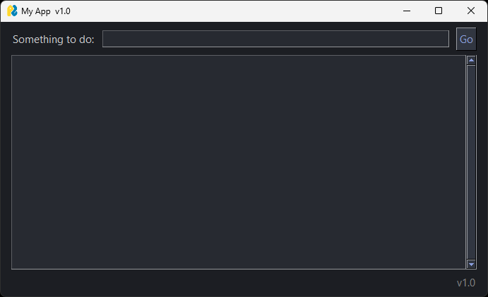</a> | - |
| 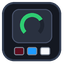<br>**Widget Template** | A card widget to build on: no title bar, see-through rounded corners on Windows, the 32 themes on a menu of color chips, a Brightness slider, sizes, opacity and keep-on-top - all remembered. A clock shows where your own content goes.<br>`Templates/widget_template.pyw`<br><a href="psgplayground/screenshots/widget_template.png">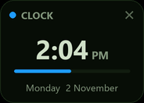</a> | pillow |
| 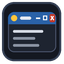<br>**Titlebar Template** | A window with the Toybox's own title bar: icon, title, version, minimize / maximize / close, drag it by the bar. Right-click to switch to the normal title bar (the default on Linux and Mac) and, on Windows 11, to round the corners.<br>`Templates/titlebar_template.pyw`<br><a href="psgplayground/screenshots/titlebar_template.png">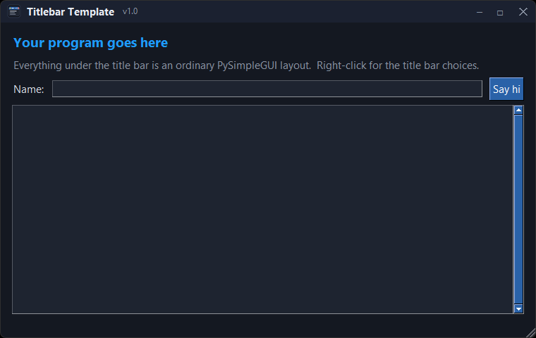</a> | - |

<!-- PROGRAMS END: the rest of this file is yours - edit it right here, a sync leaves it alone -->

## How I write these

A few habits you'll see in every file:

- **One file per program.** A single `.pyw` (no console window on Windows). Where two programs share a helper, it sits next to them.
- **Keys are constants.** `K_NAME = '-NAME-'` so my editor completes them; repeated elements use `KT_NAME = lambda n: (K_NAME, n)`.
- **A VERSION and a change log** at the top. The version shows somewhere in the window.
- **A right-click menu** with Edit Me / Version / Exit - `sg.MENU_RIGHT_CLICK_EDITME_VER_EXIT`.
- **Keyboard everywhere.** Scrollable areas take Up/Down, PgUp/PgDn, Home/End; Esc closes.
- **No silent crashes.** `main()` is wrapped so an exception shows `sg.popup_error_with_traceback` instead of vanishing (pythonw has no console).
- **Settings** persist through `sg.user_settings` - window position, last choices, tokens.

If you want the same for your own program, start from `Templates/app_template.pyw`.
For a desktop widget start from `Templates/widget_template.pyw`; for a window with its own title bar, `Templates/titlebar_template.pyw`.

## Build your own

Every program here was written with an AI assistant, and the tricks that make them feel polished are small. The [prompts](prompts/) folder
has one page per trick - the frameless window, the draggable panes, the picture buttons, drag-to-reorder, drop-a-file, background work -
each with a prompt you can paste into any chatbot and the few PySimpleGUI calls it needs to get right.

## About this repo

Like all PySimpleGUI repos, pull requests aren't taken.  Have a question or problem?  Feel free to open an issue.

`dev/` holds the tools I use to copy the programs in from my working folders and build this README; it isn't part of the Playground.

## License

LGPL 3 - see [LICENSE](LICENSE).
