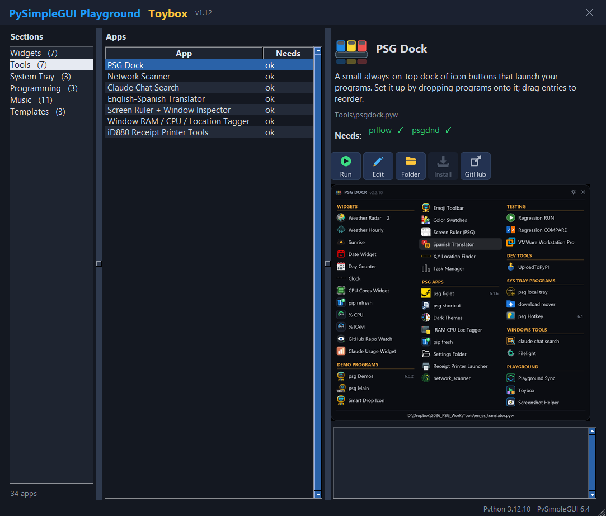

# A window with no title bar

**What you get:** a clean, frameless window like the Toybox or the PSG Dock - no OS title bar, dragged by a strip across the top,
a ✕ at the right end of that strip, a size grip in the bottom-right corner, and it still shows on the Windows taskbar so it can't get lost.



## Prompt

```
Write a PySimpleGUI 6 program (a single .pyw file) with a window that has NO operating-system title bar.
Instead, the top row of the layout is a shaded strip holding the program name on the left and a "✕" on the right.
Requirements:
- Dragging anywhere on that strip moves the window. Nothing else in the window moves it.
- Clicking the ✕ closes the program; Escape closes it too. The ✕ turns red when the mouse is over it.
- The window is resizable with a size grip in the bottom-right corner.
- On Windows the window must still appear on the taskbar (frameless tk windows normally drop off it).
- The window remembers its position and size between runs.
- A right-click menu offers "Show title bar" which restarts the window with a normal frame, and "Hide title bar" to go back.
Below the strip put any simple content (a few text lines and a multiline) so the resizing is visible.
```

## Hints for the model

```
- sg.Window(..., no_titlebar=True, resizable=True, margins=(0, 0), finalize=True, auto_save_location=True)
- The strip: sg.Column([[sg.Text(name, background_color=BAR), sg.Push(background_color=BAR), sg.Text(' ✕ ', key='-CLOSE-', enable_events=True, background_color=BAR)]],
  key='-HEADER-', background_color=BAR, expand_x=True, pad=(0, 0))
- Dragging: bind '<ButtonPress-1>' and '<B1-Motion>' on the strip's frame (window['-HEADER-'].Widget) and on each of its children
  except the ✕. On press store e.x_root - root.winfo_x() and e.y_root - root.winfo_y() (root = window.TKroot); on motion
  root.geometry(f'+{e.x_root - dx}+{e.y_root - dy}').
- Hover on the ✕: widget.bind('<Enter>', ...) / '<Leave>' and widget.configure(fg=..., bg=...).
- Size grip: sg.Sizegrip() as the last element of the bottom row.
- Taskbar (Windows only): after finalize,
      hwnd = ctypes.windll.user32.GetParent(window.TKroot.winfo_id())
      style = GetWindowLongW(hwnd, -20);  SetWindowLongW(hwnd, -20, (style | 0x00040000) & ~0x00000080)   # WS_EX_APPWINDOW, not TOOLWINDOW
      window.TKroot.withdraw(); window.TKroot.after(10, window.TKroot.deiconify)
- Remembering size: sg.user_settings_get_entry('-size-') at creation (size=...), sg.user_settings_set_entry('-size-', list(window.size)) on exit.
  Position is handled by auto_save_location=True.
- The title-bar toggle: save the choice with sg.user_settings_set_entry, close the window, build it again with no_titlebar=not choice.
- Don't use grab_anywhere=True - the whole window would move when you drag inside a list or a text box.
```
