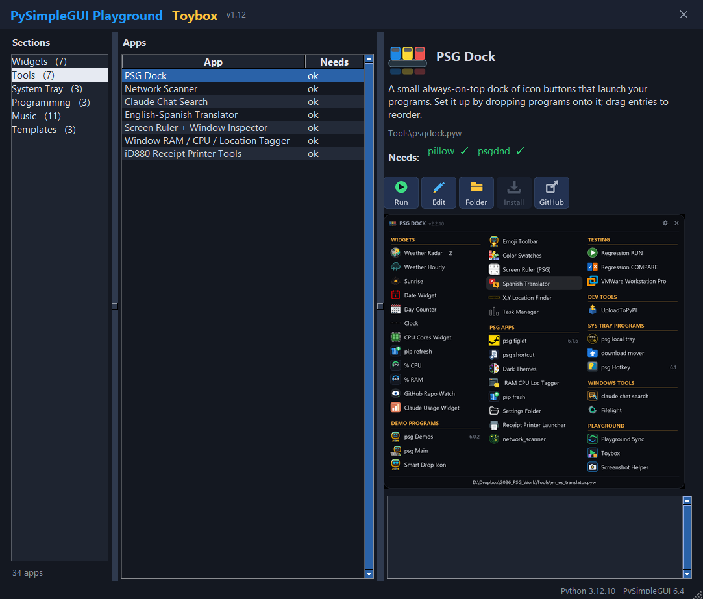

# Picture buttons

**What you get:** buttons that are pictures - a flat icon everyone recognises (green play = Run, blue pencil = Edit, yellow folder...)
next to its label - so nobody has to hover for a tooltip. Each has a greyed "off" version, and a narrow version with the label under
the icon for when the window is small. The pictures are embedded in the program as base64 so it stays one file.



## Prompt

```
Write a PySimpleGUI 6 program (single .pyw) with a row of six buttons that are pictures, not text:
Run (green disc with a white play triangle), Run demo (green ring with a play triangle), Edit (blue pencil),
Open folder (yellow folder), Install (orange arrow pointing down into a tray), GitHub (grey box with an arrow leaving it).
Each picture is a rounded dark button face with the icon on the left and the label text on the right, 118x34 pixels.
Requirements:
- Draw the pictures with Pillow in a separate small script that outputs them as base64 strings; paste those strings into the
  program as a dict so the program itself needs only PySimpleGUI.
- Make an "off" version of each (grey icon, dim text) and swap it in when the button doesn't apply. Do NOT disable the tk widget
  (disabled images render stippled); instead ignore the click in the event loop while the button is off.
- Make a second, narrow layout of each picture: 54x50 with the icon above a one-word label. When the window is narrower than
  about 800 px switch all six to the narrow pictures; switch back when it widens.
- The buttons sit on the window background with no border so only the picture shows.
```

## Hints for the model

```
- sg.Button('', key=K, image_data=png_bytes, button_color=(BG, BG), mouseover_colors=(BG, BG), border_width=0)
  Swap pictures with window[K].update(image_data=other_png_bytes). Change spacing with window[K].Widget.pack_configure(padx=..., pady=...).
- Pillow: draw at 3x on an RGBA image, ImageDraw.rounded_rectangle for the face, simple polygons/ellipses for the icon,
  ImageFont.truetype('segoeui.ttf' or 'arial.ttf') for the label, then resize(..., Image.LANCZOS) and
  quantize(colors=128, method=Image.FASTOCTREE) before saving to PNG - about 1 KB each.
  base64.b64encode(png_bytes) -> the string to paste;  base64.b64decode(string) -> what image_data wants.
- Switching layouts: bind '<Configure>' on the window (or the pane the buttons live in) and compare widths; keep a dict of
  which buttons are currently "on" so the swap picks the right on/off picture.
- Keep labels at 12 px or larger; never rely on an icon alone.
```
